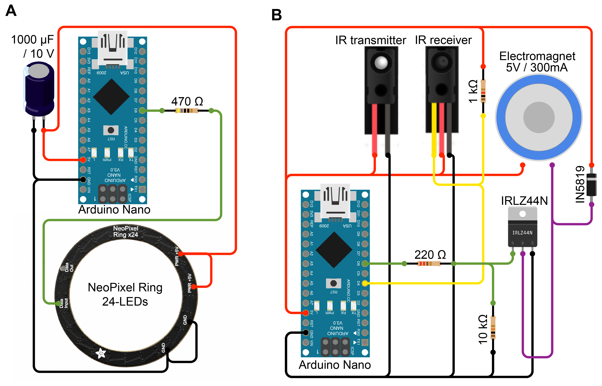

# POLAR BEAR

POLAR BEAR is a research platform for automated, top-down optical contact-angle measurements. The repository collects the measurement-analysis software, embedded firmware, electronics diagram, and mechanical assembly used for the station.

Instrument motion, liquid handling, imaging, and protocol coordination are provided by [CubOS](https://github.com/Ursa-Laboratories/CubOS). Polar Bear station support was developed in [CubOS pull request 373](https://github.com/Ursa-Laboratories/CubOS/pull/373).

## Repository contents

| Path | Contents |
| --- | --- |
| `software/polar/` | POLAR contact-angle analysis web application, scientific routines, tests, deployment files, and validation notes |
| `firmware/capper/` | Arduino Nano firmware for cap sensing and electromagnet control |
| `firmware/ring-light/` | Arduino Nano firmware for the 24-pixel RGBW illumination ring |
| `hardware/electronics/` | Wiring diagram for the ring-light and capper modules |
| `hardware/cad/` | Mechanical assembly download notes and SHA-256 checksum |
| `data/` | Data-availability and recommended dataset organization |

## Analysis software

POLAR (Precise Optical Liquid Angle Resolver) is a local web application for analyzing top-down telecentric droplet images. It supports known-volume measurements, focus stacks, time series, position scans, manual LED-pair annotation, experimental outline-based volume estimation, and OWRK surface-energy analysis.

```bash
cd software/polar
python3 -m venv .venv
source .venv/bin/activate
python -m pip install -r requirements.txt
python app.py
```

Open <http://127.0.0.1:8765>. See [`software/polar/README.md`](software/polar/README.md) for calibration, filename conventions, deployment, API, and uncertainty details. The measured software checks and current limitations are documented in [`software/polar/VALIDATION.md`](software/polar/VALIDATION.md).

## Firmware

Both modules communicate over USB serial at 115200 baud.

- The capper module identifies as `CAP_MODULE` and supports cap sensing and magnet control.
- The ring-light module identifies as `LIGHT_MODULE` and supports white, RGB, RGBW, brightness, and off commands.

The ring-light sketch requires the Arduino `Adafruit_NeoPixel` library. Pin assignments and the serial command protocol are documented in the sketches.

## Hardware



The uncompressed CAD assembly is larger than GitHub's regular 100 MB file limit. A gzip-compressed copy is versioned at `hardware/cad/POLAR-CAD-Assembly.step.gz` so repository and Zenodo snapshots contain the complete assembly. The uncompressed STEP file is also distributed as a GitHub release asset. Both forms are verified by the checksum in `hardware/cad/POLAR-CAD-Assembly.step.sha256`.

## CubOS integration

CubOS remains the source of truth for physical instrument coordination. This repository focuses on the Polar Bear station's analysis software, firmware, electronics, CAD, and research documentation. Protocols and station configuration that must execute through CubOS should cite both repositories and record the CubOS commit or release used for each experiment.

## Reproducibility status

The software repository includes automated tests and measured validation notes. Hardware-specific calibration, physical Pi deployment, and experimental accuracy have limits documented in the validation file. Raw measurement data are not present in the source folder used to assemble this repository; see [`data/README.md`](data/README.md).

## License and citation

This repository is released under the [MIT License](LICENSE). Citation metadata is intentionally left open so it can be completed in Zenodo when the repository is archived and a DOI is issued.
